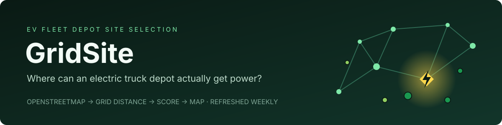
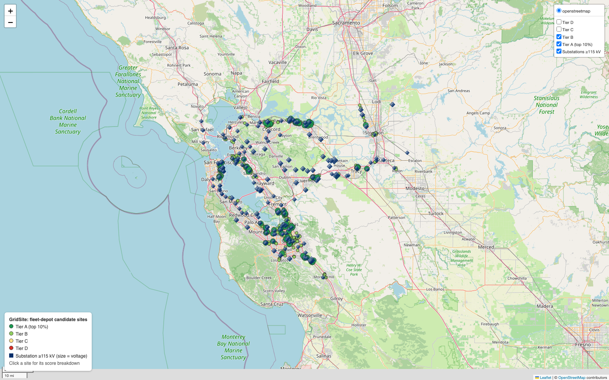
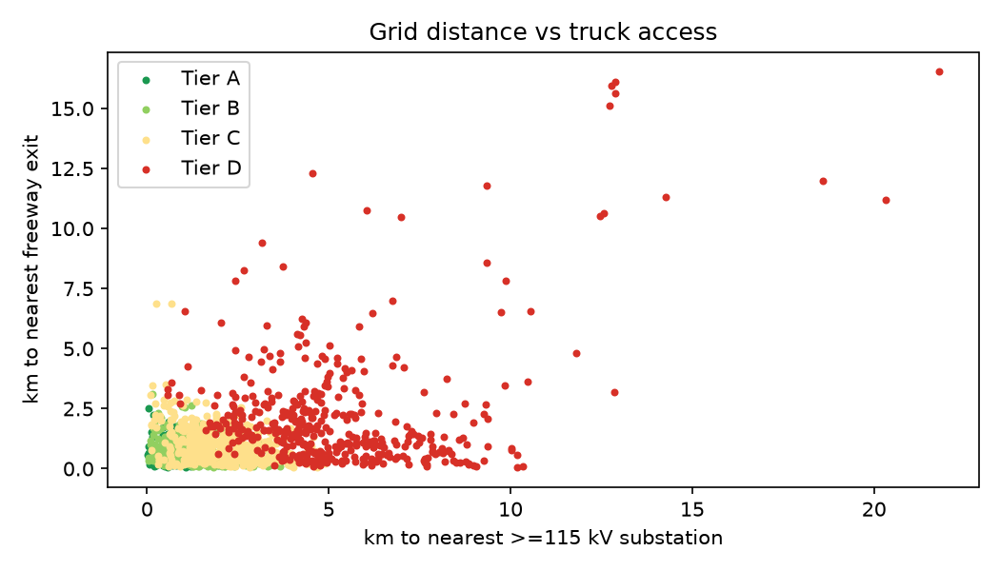
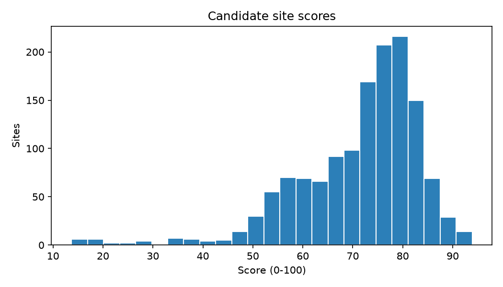
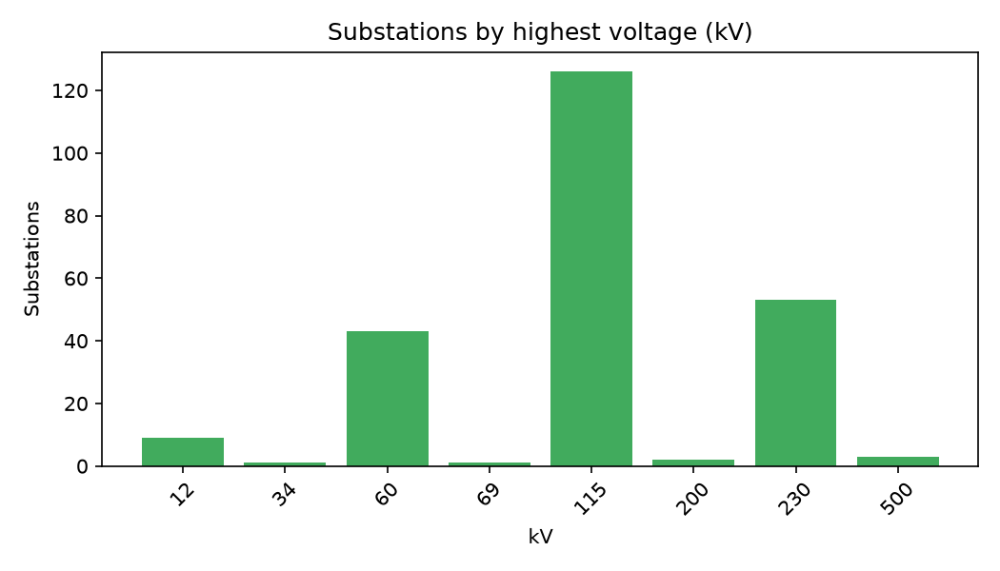
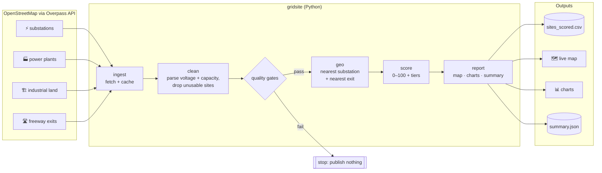
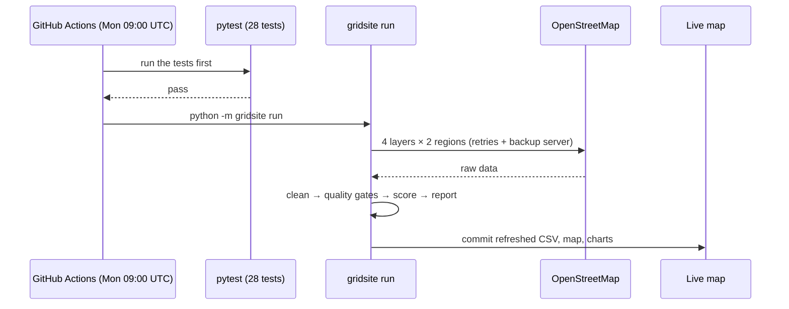
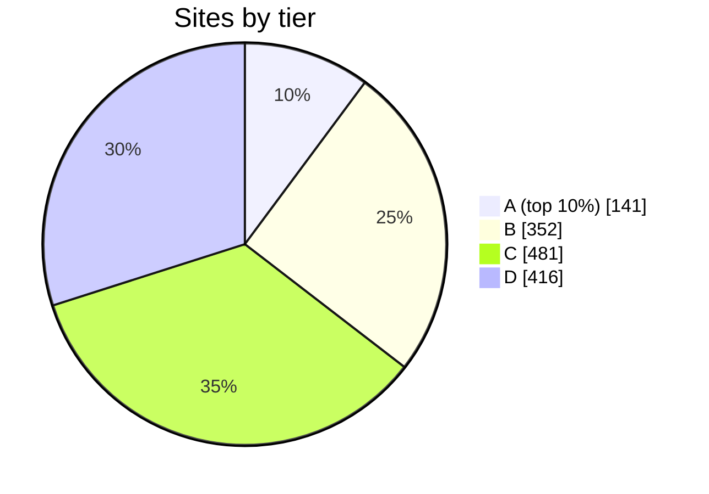

<p align="center"></p>

<p align="center">
  <a href="https://github.com/aryaMehta26/gridsite/actions/workflows/ci.yml"></a>
  <a href="https://github.com/aryaMehta26/gridsite/actions/workflows/refresh.yml"></a>
  
  
  <a href="LICENSE"></a>
</p>

**GridSite scores every sizeable industrial site in the San Francisco Bay Area and the Stockton / Central Valley freight corridor on one question: if you wanted to charge a fleet of electric trucks here, how close is the power?** It pulls public grid data every week, ranks 1,390 sites, and publishes the result as a map anyone can click through.

[🗺️ Open the live map](https://aryamehta26.github.io/gridsite/) · [📄 Download the scores (CSV)](data/processed/sites_scored.csv) · [Run it yourself](#run-it) · [How a site is scored](#how-a-site-is-scored)

<p align="center">
  <a href="https://aryamehta26.github.io/gridsite/"></a>
  <br><sub>Green dots are the best sites, dark-blue diamonds are high-voltage substations. Click the image for the live map.</sub>
</p>

## The 30-second version

An electric truck depot isn't limited by chargers. It's limited by **power**. Charging dozens of trucks overnight takes megawatts, about as much as a small neighborhood, and the cheapest, fastest way to get that much power is to build **right next to the high-voltage grid**. Build far from it and you can wait years and pay millions for new lines.

So the first question in picking a depot site is a map question: **which empty industrial lots sit close to a big substation *and* close to the freeway the trucks already drive?**

GridSite answers that for two regions, using only public data, and refreshes the answer every Monday:

| | |
|---|---|
| 🏭 Industrial sites scored | **1,390** (≥ ~2 acres; power plants and hazardous uses excluded) |
| ⚡ Substations mapped | **536**, of which **184** are high-voltage (≥ 115 kV) |
| 🛣️ Freeway exits checked | **1,591** |
| 📏 Typical distance from a site to the high-voltage grid | **2.05 km** (median) |
| ✅ Automated tests | **28**, run on every change |
| 🔄 Data refresh | **weekly**, automatically |

<sub>From the run on 2026-10-28. Every refresh rewrites [`summary.json`](data/processed/summary.json).</sub>

## What it found

**The Bay Area is grid-rich and Stockton looks grid-poor.** That's the headline:

| Region | Sites | High-voltage substations | Typical distance to one | Median score | Top-tier sites |
|---|---:|---:|---:|---:|---:|
| 🌉 Bay Area | 912 | 168 | **1.67 km** | 77.0 | **136** |
| 🚚 Stockton / Central Valley | 478 | 16 | **3.49 km** | 65.5 | **5** |

Stockton is one of the most important freight hubs in California, exactly where fleets will electrify, yet the public map shows **10× fewer high-voltage substations** and **twice the distance** to reach one. Either that's a real constraint on electrifying Central Valley freight, or OpenStreetMap is missing substations there. Either way, it's the first thing to check against the utility's own maps.

**The best sites cluster along the transmission backbone:**

| Rank | Score | Next to | Voltage | To the substation | To a freeway exit |
|---:|---:|---|---:|---:|---:|
| 1 | 93.9 | Metcalf Substation, south San José | 500 kV | 0.41 km | 0.76 km |
| 2 | 93.8 | Las Positas Substation, Livermore | 230 kV | 0.25 km | 0.20 km |
| 3 | 93.1 | Contra Costa Substation | 230 kV | 0.09 km | 0.51 km |
| 4 | 92.6 | Northern Receiving Station, Santa Clara | 230 kV | 0.09 km | 0.45 km |
| 5 | 92.2 | Contra Costa Power Plant Substation | 230 kV | 0.80 km | 0.13 km |

Every one of the top five is **within a kilometer of a 230–500 kV substation *and* under a kilometer from a freeway exit.**

<p align="center">
  
  
</p>
<p align="center">
  
</p>

## How to read the map

- 🟢 **Dark green**: Tier A, the top 10% of sites. Bigger dots, drawn on top.
- 🟢 **Light green**: Tier B, the next 25%.
- 🟡 🔴 **Yellow / red**: Tiers C and D, hidden by default. Tick them in the top-right box.
- 🔷 **Dark-blue diamonds**: substations at 115 kV or more. Bigger diamond, higher voltage.
- **Click any site** to see its rank, score, size, the substation it's closest to, its distance to the freeway, nearby power generation, and a link to the satellite view.

## How it works



Every Monday, GitHub Actions re-runs the whole thing on fresh data:



## How a site is scored

Each factor is scaled from 0 to 1, weighted, and added up to a **0–100 score**. All weights live in one file, [`gridsite/config.py`](gridsite/config.py), so the whole policy can be changed in one place.

| Factor | Weight | In plain words | Exactly |
|---|---:|---|---|
| ⚡ Grid proximity | **40%** | How close is the big grid? | Distance to the nearest ≥ 115 kV substation: 1.0 on top of it, falling to 0 at 10 km |
| 🔌 Voltage class | **20%** | How big is that substation? | ≥ 345 kV → 1.0 · ≥ 230 kV → 0.8 · ≥ 115 kV → 0.5 |
| 🛣️ Truck access | **25%** | Can trucks get in and out easily? | Distance to the nearest freeway exit: 1.0 at the exit, 0 at 5 km |
| 🏭 Local generation | **15%** | Is there power being made nearby? | Published plant capacity within 10 miles, log-scaled so 1 GW → 1.0 |

**Tiers are percentiles**: top 10% → **A**, next 25% → **B**, next 35% → **C**, the rest → **D**. A tier always means the same share of sites, however the weights are tuned.



## Quality gates

The pipeline **refuses to publish** if the data looks wrong ([`checks.py`](gridsite/checks.py)):

- every layer has a minimum row count, so an empty download fails loudly instead of producing an empty map
- no missing coordinates; every point is valid and inside its region
- no duplicate OpenStreetMap ids
- every score is between 0 and 100, and no distance is negative

These gates paid off on the very first real run. Overpass returns **only a bounding box** for areas in `out center bb` mode, so every industrial site was silently dropped. The row-count gate stopped the pipeline instead of publishing an empty map. The fix (take the center of the bounding box) now has its own test.

## Run it

Requires Python 3.12+. No API keys, no accounts.

```bash
git clone https://github.com/aryaMehta26/gridsite.git
cd gridsite
python -m venv .venv && source .venv/bin/activate
pip install -r requirements.txt

python -m pytest -q                                   # 28 tests, no network needed
python -m gridsite run --regions bay_area stockton    # download, score, write docs/ + data/processed/
python -m gridsite run --use-cache                    # reuse downloaded data, only fetch what's missing
open docs/index.html
```

Want another region? Add a bounding box to `REGIONS` in [`config.py`](gridsite/config.py).

<details>
<summary><b>Project layout</b></summary>

```
gridsite/
├── gridsite/
│   ├── config.py      # regions, weights, thresholds: the whole scoring policy
│   ├── overpass.py    # Overpass client: POST, retries, backup server
│   ├── ingest.py      # one query per layer -> data/raw/<region>_<layer>.json
│   ├── clean.py       # voltage / capacity parsing, site filtering, area from bbox
│   ├── geo.py         # haversine distance, chunked nearest-neighbor, radius search (numpy only)
│   ├── score.py       # factors, weights, percentile tiers
│   ├── checks.py      # data quality gates
│   ├── report.py      # folium map, matplotlib charts, summary.json
│   └── __main__.py    # command line
├── tests/             # 28 tests on hand-made Overpass fixtures
├── data/processed/    # scored sites, high-voltage substations, summary
├── docs/              # GitHub Pages: live map, charts, header
└── .github/workflows/ # ci.yml (tests on every push) · refresh.yml (weekly rebuild)
```
</details>

## Limitations (read before trusting a ranking)

- **Being near a substation isn't the same as having capacity at it.** A 230 kV substation next door says nothing about whether it has spare headroom. Utilities publish capacity maps that answer that; GridSite doesn't use them yet.
- **OpenStreetMap coverage varies.** Missing or untagged substations make an area look worse than it is (see Stockton).
- **Site size is approximate.** It comes from each parcel's bounding box, which overestimates irregular shapes.
- **Distances are straight-line**, not along roads or power-line corridors.
- **Zoning, land price, and availability aren't modeled.** This is a first-pass screen, not a siting decision.

## What's next

- [ ] Add the CAISO interconnection queue to weight sites by *planned* capacity, not just what's built today
- [ ] Join utility capacity data where it's published
- [ ] Use real parcel shapes instead of bounding boxes
- [ ] Export a CARTO-ready layer
- [ ] Add more freight regions: Inland Empire, Port of Oakland drayage, the I-5 corridor

## Data & license

Map data © [OpenStreetMap contributors](https://www.openstreetmap.org/copyright), available under the [Open Database License (ODbL)](https://opendatacommons.org/licenses/odbl/). Code under the [Apache License 2.0](LICENSE).

Built by [Arya Mehta](https://github.com/aryaMehta26).
